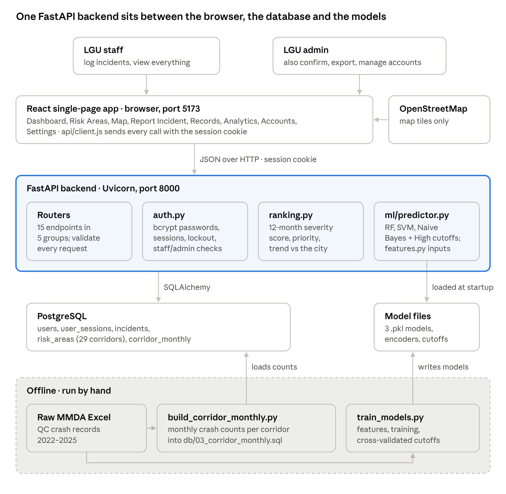
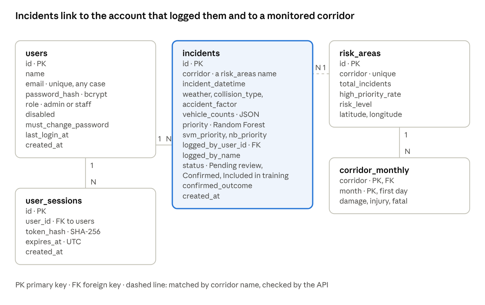
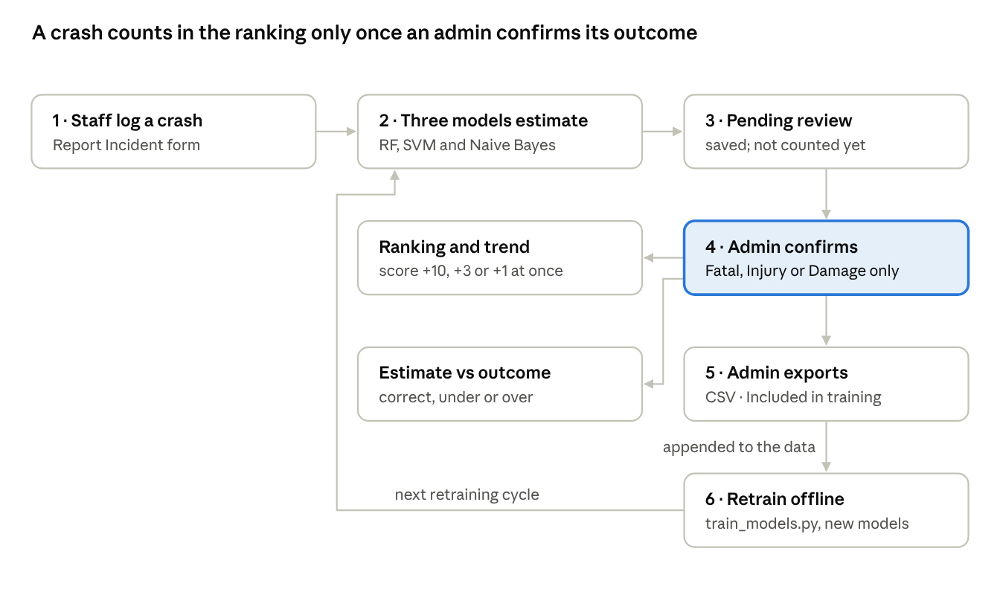
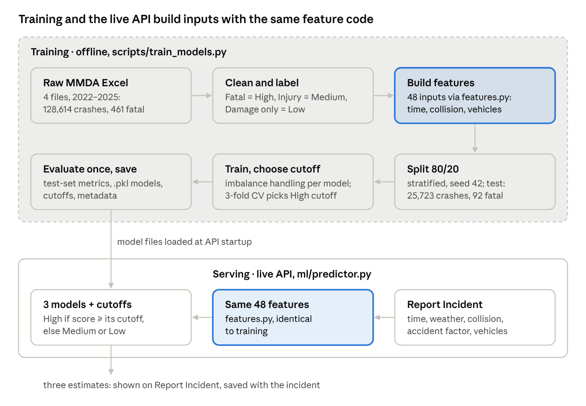

# QC Road Safety System Design & Architecture

The QC Road Safety Accident Risk System is a three-tier web application: a React single-page app talks to a FastAPI backend, which reads and writes a PostgreSQL database and serves three trained models (Random Forest, SVM, Naive Bayes) loaded from files.

**Contents:** [Architecture](#architecture-at-a-glance) · [Technology stack](#technology-stack) · [Components](#components) · [Data model](#data-model) · [Incident lifecycle](#incident-lifecycle) · [Ranking and trend](#corridor-ranking-and-trend-logic) · [ML pipeline](#machine-learning-pipeline) · [API](#api) · [Security](#security-design) · [Deployment](#deployment-and-configuration) · [Testing](#testing) · [Design limits](#design-limits)

## Architecture at a glance



The browser never touches the database or the models directly: every request goes through the API, which checks the session first. The offline scripts (dashed) run by hand when new MMDA data arrives or the models are retrained.

## Technology stack

Every layer uses open-source tools; the only pinned version is scikit-learn, because saved models load reliably only on the version that trained them.

| Layer | Technology | Job in this system |
| --- | --- | --- |
| Frontend | React, Tailwind CSS | Single-page app: pages, navigation, light/dark theme, English/Tagalog menus |
| Map | Leaflet 1.9 + react-leaflet 5, OpenStreetMap tiles | Corridor markers coloured by priority, with trend in each popup |
| Backend | Python, FastAPI, Uvicorn | REST API, input validation, sign-in, permission checks |
| Data access | SQLAlchemy 2.1, psycopg2 | Maps Python objects to PostgreSQL tables |
| Database | PostgreSQL (developed on 18) | Accounts, sessions, logged incidents, corridors, monthly crash counts |
| Machine learning | scikit-learn 1.6.1, pandas, NumPy, joblib | Loads the three models and runs predictions |
| Training (offline) | imbalanced-learn 0.14.2 (SMOTE), openpyxl | Retrains the models from the raw MMDA Excel files |
| Security | bcrypt, httpOnly session cookies | Password hashing and server-side sessions |
| Testing | pytest, Vitest + Testing Library + jsdom, Playwright | Backend, page-level and real-browser tests |

## Components

The backend keeps business logic in a few focused modules; the routers only validate requests, check permissions and call them.

**Backend (`backend/app`)**

| Module | Responsibility |
| --- | --- |
| `main.py` | Creates the app, sets CORS, loads the models at startup, requires sign-in on every router except sign-in |
| `auth.py` | Password hashing (bcrypt), sessions, the failed-sign-in lockout, and the `current_user` / `require_admin` checks |
| `database.py` | PostgreSQL connection and one database session per request |
| `models.py` / `schemas.py` | Table definitions, and the shapes of API requests and responses |
| `ranking.py` | The 12-month severity ranking, the trend arrows, and how confirmed incidents add to both |
| `ml/features.py` | Feature engineering, shared by training and the live API so both build identical inputs |
| `ml/predictor.py` | Loads the three models and their High cutoffs, turns a report into three estimates |
| `routers/` | `auth`, `users`, `risk_areas`, `predict`, `incidents`: one file per group of endpoints |

**Offline scripts and data (`backend/scripts`, `backend/db`, `backend/models`)**

| Item | Responsibility |
| --- | --- |
| `train_models.py` | Rebuilds the three models, their cutoffs and metadata from the raw MMDA files |
| `build_corridor_monthly.py` | Turns new MMDA files into monthly crash counts per corridor (`03_corridor_monthly.sql`) |
| `build_form_options.py` | Builds the Report Incident dropdown values from the data |
| `create_admin.py` | Creates or resets an admin account from the command line |
| `db/01`–`05_*.sql` | Create the tables, seed the 29 corridors, load monthly counts, add model estimates, add sign-in |
| `models/` | The three `.pkl` models, label encoders, `priority_model_config.json` (cutoffs), metadata |

**Frontend (`frontend/src`)**

| Part | Responsibility |
| --- | --- |
| Dashboard | Priority counts, top 5 corridors, corridors rising faster than the city |
| Risk Areas / Map | All 29 corridors with score, trend and priority; the same on a map |
| Report Incident | The crash form; shows all three models' estimates and saves the incident |
| Records | Logged incidents; admins confirm outcomes and export for retraining |
| Analytics | Test-set results, before/after model update, live estimate-vs-outcome counts, feature importance |
| Accounts (admin) / Settings | Staff accounts and temporary passwords; theme, language, change password |
| `auth/`, `incidents/` | Shared state: who is signed in, the list of incidents |
| `api/client.js` | Every API call, with the session cookie, readable errors and sign-out on an expired session |

## Data model



Five tables hold everything: accounts and their sessions on the left, logged incidents in the middle, and the 29 corridors with their 1,392 monthly crash counts (2022–2025) on the right. Each incident stores all three models' estimates next to the outcome an admin confirms, which is what Records and Analytics compare.

## Incident lifecycle



Only confirmed outcomes ever reach the ranking or the training data, so the models never learn from their own guesses. An incident moves through three statuses: Pending review, Confirmed, Included in training; an exported incident can no longer be changed.

## Corridor ranking and trend logic

Corridor priority is a transparent rule, not a model: in a 2025 backtest the 12-month severity ranking (82.2% accuracy, 91.7% precision on High) beat Random Forest, SVM and Naive Bayes at road-level forecasting. The logic lives in `backend/app/ranking.py` and runs on every request, so it always reflects the latest confirmed incidents.

**Severity score** for each of the 29 corridors, over the 12 most recent months of MMDA data plus every confirmed incident from the start of that window to today:

```math
\text{score} = 1 \cdot \text{damage only} + 3 \cdot \text{injury} + 10 \cdot \text{fatal}
```

1. Sort corridors by score (ties broken by crash count, then name).
2. Ranks 1–10 = High, 11–20 = Medium, 21–29 = Low.
3. A confirmed incident adds its outcome's points at once; a pending one adds nothing, because only a model's estimate exists for it.

**Trend** compares each corridor's score over the last 6 months of data with the 6 months before, relative to the whole city:

```math
\text{relative change} = \left(\frac{\text{recent}}{\text{before}} - 1\right) - \left(\frac{\text{city recent}}{\text{city before}} - 1\right)
```

- Rising: relative change of +15 points or more. Falling: −15 points or less. Steady: in between.
- Comparing with the city removes the season effect; a corridor compared only with itself put 21 of 29 corridors on Rising at the end of 2025.
- Confirmed incidents add their points to the period they fall in, so a log can only push a corridor toward Rising.
- Backtest on 2022–2025: the arrow's direction still held over the next 3 months 77% of the time (72% in 2025); Rising corridors stayed above the city trend 79% of the time, versus 50% for Steady ones.

## Machine learning pipeline



Because training and the API call the same `features.py`, a crash typed into the form becomes exactly the inputs the models learned from; a check on 392 test crashes found zero differences. Test-set results after the update:

| Model | Training setup | Precision on High | Recall on High | Accuracy |
| --- | --- | --- | --- | --- |
| Random Forest | 100 trees, depth 15; gentler SMOTE | 15.8% | 45.7% | 84.4% |
| SVM (linear) | scaled features, C = 0.01, class weights | 4.3% | 83.7% | 77.7% |
| Naive Bayes | Gaussian; SMOTE | 2.1% | 91.3% | 72.1% |

Only 0.36% of crashes are fatal, so Random Forest's precision is about 44 times better than chance; the limit is the data (no speed, helmet use, victim age or response time).

## API

The API exposes 15 REST endpoints under `/api`, all JSON; only sign-in works without an account, and admin-only endpoints answer 403 to staff.

| Method and path | Who | What it does |
| --- | --- | --- |
| `POST /api/auth/login` | Anyone | Checks email and password, starts a session (8 h, or 30 days with Remember me) |
| `POST /api/auth/logout` | Signed in | Ends this browser's session |
| `GET /api/auth/me` | Signed in | Returns the signed-in account |
| `POST /api/auth/change-password` | Signed in | Changes own password, clears the temporary-password flag, signs out other browsers |
| `GET /api/users` | Admin | Lists all accounts |
| `POST /api/users` | Admin | Creates a staff account with a one-time temporary password |
| `POST /api/users/{id}/reset-password` | Admin | Issues a new temporary password and ends that account's sessions |
| `PATCH /api/users/{id}` | Admin | Disables or enables an account (disabling ends its sessions) |
| `GET /api/risk-areas` | Signed in | The ranking: score, priority, trend and confirmed incidents for all 29 corridors |
| `GET /api/form-options` | Signed in | Dropdown values for the Report Incident form |
| `POST /api/predict-incident` | Signed in | Three models' estimates (High / Medium / Low) for a described crash |
| `GET /api/incidents` | Signed in | All logged incidents, newest first |
| `POST /api/incidents` | Signed in | Logs an incident with the three estimates, credited to the signed-in account |
| `POST /api/incidents/{id}/confirm` | Admin | Records the real outcome (Fatal / Non Fatal Injury / Damage to Property) |
| `POST /api/incidents/export` | Admin | Returns confirmed incidents for the CSV and marks them Included in training |

Interactive documentation for every endpoint is generated automatically at `/docs` (FastAPI).

## Security design

The server enforces every rule; the frontend only hides what a role can't use. Two roles exist: staff log incidents and view everything, and admins also confirm outcomes, export for retraining and manage accounts.

| Concern | Design |
| --- | --- |
| Passwords | Stored as bcrypt hashes only. Own passwords need 8+ characters with a letter and a number. Emails match in any letter case; passwords must match exactly |
| Accounts | Only an admin creates staff accounts. The server generates a 10-character temporary password, shown once; the user is reminded on every page until they set their own. The first admin is made with `create_admin.py` |
| Sessions | A random token in an httpOnly, SameSite=Lax cookie that page scripts can't read. The database stores only its SHA-256 hash. Lasts 8 hours (or until the browser closes), 30 days with Remember me |
| Ending sessions | Sign-out, a password change (other browsers), an admin reset, or disabling an account ends sessions immediately |
| Guessing | 5 wrong passwords lock that email for 15 minutes. A wrong email and a wrong password get the same answer and take the same time, so attackers can't tell which accounts exist |
| Permissions | `current_user` on every protected route, `require_admin` on admin routes. Incidents are credited to the signed-in account, never to a name sent by the browser |
| Browser access | CORS allows only the configured frontend addresses. `COOKIE_SECURE=true` keeps the cookie off plain HTTP when served over HTTPS |
| Secrets | The database password lives in `backend/.env`, which is never committed |

## Deployment and configuration

The prototype runs on one computer as three processes: PostgreSQL, the API on port 8000 (Uvicorn) and the frontend on port 5173 (Vite). The browser must reach the app and the API on the same host name (for example both on `localhost`), because the sign-in cookie is only sent within one site.

| Setting | Where | Default | Purpose |
| --- | --- | --- | --- |
| `DATABASE_URL` | `backend/.env` | required | PostgreSQL connection, `postgresql+psycopg2://` prefix |
| `CORS_ORIGINS` | `backend/.env` | `localhost` and `127.0.0.1` on port 5173 | Browser addresses allowed to call the API |
| `COOKIE_SECURE` | `backend/.env` | `false` | `true` when served over HTTPS |
| `VITE_API_URL` | `frontend/.env.local` | port 8000 on the page's host name | Where the frontend finds the API |

Setup order: create the database and run `db/01`–`05`, install the Python requirements, create the first admin with `create_admin.py`, start the API, then `npm install` and `npm run dev`. Data refresh and retraining are manual, offline steps (see the [machine learning pipeline](#machine-learning-pipeline)).

## Testing

Three automated suites verify the system end to end; all pass on a fresh copy of the repository (October 2026). They run only against a separate database whose name contains "test" and refuse any other, because they create and delete data.

| Suite | Command | Size | What it verifies |
| --- | --- | --- | --- |
| Backend | `pytest -s` | 7 tests, 111 checks | Scores and trend arrows recounted independently with SQL; incident flow; sign-in, sessions, roles, lockout; each model's cutoff; optionally, that the models reproduce the published test-set results and that the API matches the training pipeline on 392 crashes |
| Frontend end to end | `npm run test:e2e` | 9 tests | Real pages against the real API: ranking, trends, log → confirm → ranking → export, estimate-vs-outcome counts, error states |
| Browser | `npm run test:browser` | 25 steps | Sign-in and account management clicked through in Chromium, with screenshots |

Setup and run instructions: [`backend/tests/README.md`](../backend/tests/README.md) and [`frontend/tests/README.md`](../frontend/tests/README.md).

## Design limits

The design targets a single-site prototype, not live deployment:

- **Manual data refresh.** New MMDA files and retraining are run by hand; there is no live link to MMARAS or police records.
- **No coordinates.** Corridors are matched by street name and placed on the map by hand; crashes on unlisted streets are left out (the 29 corridors cover about 74% of crashes).
- **Location is not a model input.** The models estimate severity from time, weather, collision type, accident factor and vehicles.
- **Prototype-grade sign-in.** No email password reset or two-factor sign-in; the lockout counter is in memory and resets when the API restarts.
- **One server.** No load balancing or replicas; fine for one LGU office, not for public traffic.
